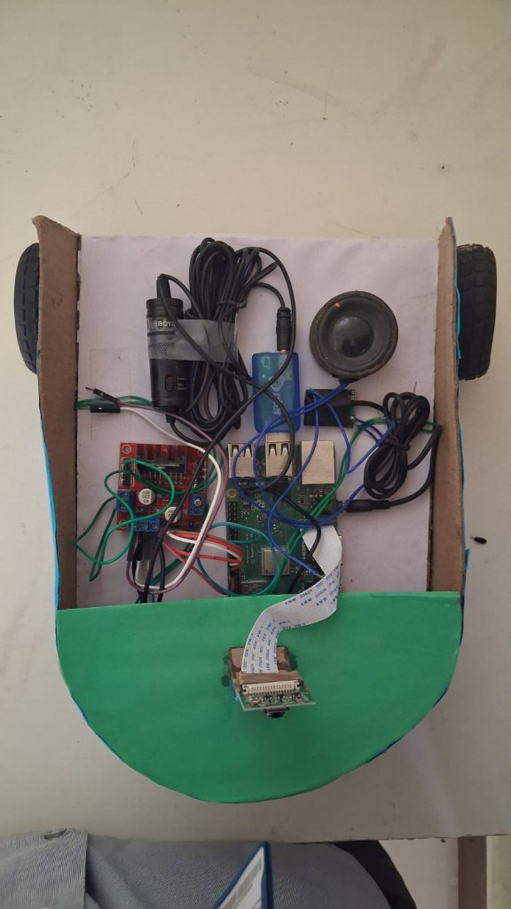
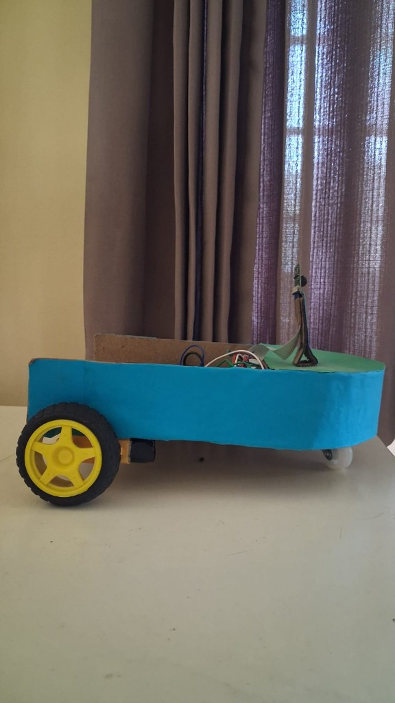

<div align="center">

# Visio-AI
### A voice-controlled Raspberry Pi vision robot

**Embedded Systems · Robotics · Computer Vision · IoT · Python**

[Project Overview](#project-overview) · [Features](#implemented-software-features) · [Hardware](#hardware) · [Setup](#setup) · [Run](#run-the-project) · [Safety](docs/SAFETY_AND_PRIVACY.md)

</div>

<p align="center">
  
  
</p>

## Project overview

Visio-AI is a Raspberry Pi-based mobile robot prototype that combines voice commands, motor control, camera input, object detection and optional cloud-based conversational responses. The repository contains the Python application, camera utilities, YOLO streaming tools and supporting documentation.

The project is presented as an engineering prototype. The repository documents the implemented code paths; it does **not** contain measured accuracy, latency, battery-life or runtime benchmarks. Hardware-dependent functions must be validated on the exact Raspberry Pi, camera, audio devices and motor wiring used for the build.

## Implemented software features

| Area | Repository implementation | Notes / dependencies |
|---|---|---|
| Voice input | `SpeechRecognition` with Google speech recognition | Requires internet access for `recognize_google`. |
| Voice output | `espeak` + `aplay` | Requires Linux audio packages and a configured output device. |
| Mobile platform | L298N dual H-bridge motor control through `RPi.GPIO` | Uses BCM GPIO pins listed below. Test with wheels raised before floor operation. |
| Camera capture | Picamera2 with OpenCV webcam fallback | Camera hardware and permissions required. |
| Object detection | Ultralytics YOLOv8 Nano in local and browser-stream scripts | First run may download model weights; performance depends on Pi model and configuration. |
| Face detection / matching prototype | OpenCV Haar cascade plus simple grayscale feature vectors | Experimental; not a production-grade identity-recognition system. See [known limitations](docs/DEVELOPMENT_STATUS.md). |
| Conversational AI | Optional Groq API client | Requires a user-supplied `GROQ_API_KEY`; cloud service and internet required. |

## Hardware

The supplied photographs show a Raspberry Pi-based chassis, an L298N-style motor driver, a camera module, two drive wheels, a caster and an audio speaker. The project scripts additionally expect a microphone and compatible camera interface. Confirm your exact board revisions, power supply ratings and peripheral models before wiring.

### Motor driver GPIO mapping

The main control script uses Raspberry Pi BCM numbering:

| Signal | BCM GPIO | Purpose |
|---|---:|---|
| ENA | 18 | Motor 1 PWM enable |
| IN1 | 23 | Motor 1 direction |
| IN2 | 24 | Motor 1 direction |
| ENB | 12 | Motor 2 PWM enable |
| IN3 | 25 | Motor 2 direction |
| IN4 | 8 | Motor 2 direction |

**Electrical safety:** Do not power DC motors from Raspberry Pi GPIO pins or the Pi's 3.3 V rail. Use a motor supply appropriate for the motors and driver, connect grounds as required by the driver circuit, and verify all signal levels before powering the board. Check the motor driver's own datasheet and your actual wiring; the table above describes the software pin assignments only.

## Repository structure

```text
visio-ai/
├── README.md
├── requirements.txt
├── .env.example
├── camera_access.py
├── camera_capture.py
├── live_face_detection.py
├── object_detection_yolo.py
├── register_face.py
├── tts_rpi.py
├── video_stream_server.py
├── yolo_stream_server.py
├── opencv_cascades/
│   └── haarcascade_frontalface_default.xml
├── visio_ai_project/
│   ├── sr_mic_test.py          # Main voice-command application
│   ├── motor_control.py        # L298N driver class
│   └── visio_ai/
│       ├── ai.py               # Optional Groq integration
│       ├── audio.py            # Text-to-speech helper
│       └── stream.py           # YOLO stream process manager
├── tools/
│   └── groq_cli.py             # Optional terminal AI test
└── docs/
    ├── SYSTEM_OVERVIEW.md
    ├── DEVELOPMENT_STATUS.md
    ├── SAFETY_AND_PRIVACY.md
    └── hardware/
        ├── robot-top.jpg
        └── robot-side.jpg
```

## Setup

These instructions target Raspberry Pi OS. Some dependencies are platform-specific; installing the full stack on a regular Windows or macOS machine will not provide Raspberry Pi GPIO or Picamera2 support.

### 1. Install system packages

```bash
sudo apt update
sudo apt install -y python3-venv python3-pip python3-rpi.gpio \
  python3-picamera2 espeak alsa-utils portaudio19-dev openssl
```

If a package is unavailable for your OS image, consult the Raspberry Pi OS package guidance for that release. `python3-picamera2` is optional when using a USB webcam.

### 2. Create a Python environment

From the repository root:

```bash
python3 -m venv --system-site-packages .venv
source .venv/bin/activate
python -m pip install --upgrade pip
pip install -r requirements.txt
```

`--system-site-packages` can be useful when the OS-provided `RPi.GPIO` and Picamera2 packages are not visible inside an isolated virtual environment. If you use a different GPIO setup, adapt the environment rather than copying system paths into source code.

### 3. Configure optional Groq AI

```bash
cp .env.example .env
# Edit .env and set GROQ_API_KEY to your own key.
set -a
. ./.env
set +a
```

The Python application reads environment variables. It does not automatically parse `.env`, so the shell commands above export values into the process environment. Keep `.env` private and never commit API keys.

### 4. Check connected devices

Before running the full robot, verify the camera, microphone, speaker, GPIO permissions and motor power supply independently. Use the Raspberry Pi camera tools available for your OS release and check the ALSA device list with `aplay -l`.

## Run the project

### Main voice-controlled robot

```bash
cd visio_ai_project
python sr_mic_test.py
```

The main control loop listens for a short phrase, uses online Google speech recognition, then routes recognized commands to motor control, camera capture, stream control or the optional Groq assistant.

### Standalone YOLO camera preview

From the repository root:

```bash
python object_detection_yolo.py
```

### YOLO browser stream

```bash
python yolo_stream_server.py
```

The server binds to `127.0.0.1` by default. Open the printed local URL in a browser on the Raspberry Pi. A self-signed TLS certificate may trigger a browser warning. Do not expose this development server directly to the public internet. See [Safety and privacy](docs/SAFETY_AND_PRIVACY.md) before enabling LAN access.

### Face enrollment prototype

```bash
python register_face.py "Person Name"
python video_stream_server.py
```

Face images and feature data are written under the ignored local `data/` directory. Use only with informed consent. The current feature-matching approach is experimental and should not be used for access control, attendance, surveillance or other consequential identity decisions.

### Optional Groq terminal test

```bash
python tools/groq_cli.py
```

## Voice commands

| Phrase | Action in the main application |
|---|---|
| `forward` | Run both motors in the forward direction for approximately two seconds, then stop. |
| `backward` / `back` | Run both motors in reverse for approximately two seconds, then stop. |
| `turn left` / `go left` | Counter-rotate motors for approximately two seconds, then stop. |
| `turn right` / `go right` | Counter-rotate motors for approximately two seconds, then stop. |
| `stop` | Stop both motors. |
| `start detection` / `open camera` | Start the YOLO stream process. |
| `stop detection` / `stop camera` | Stop the stream process. |
| `take a picture` / `take a photo` | Capture a still image. |
| `quit` / `exit` | Stop the stream and exit the main loop. |

Speech recognition is online in the current main script. The project should not be described as fully offline voice control.

## Basic source check

Run a Python syntax compilation check from the repository root:

```bash
python -m compileall -q .
```

This verifies syntax only; it does not test the Pi camera, GPIO, microphone, motors, network stream or AI service.

## Current project status

See [Development status](docs/DEVELOPMENT_STATUS.md) for verified repository facts, known limitations and recommended next engineering improvements. No benchmark values or test results are claimed unless accompanied by reproducible measurements.

## Contributing

Please open an issue before proposing major architectural changes. Keep credentials, face data, personal captures, TLS private keys and downloaded model weights out of commits. See [Safety and privacy](docs/SAFETY_AND_PRIVACY.md).

## License

MIT. See [LICENSE](LICENSE).
